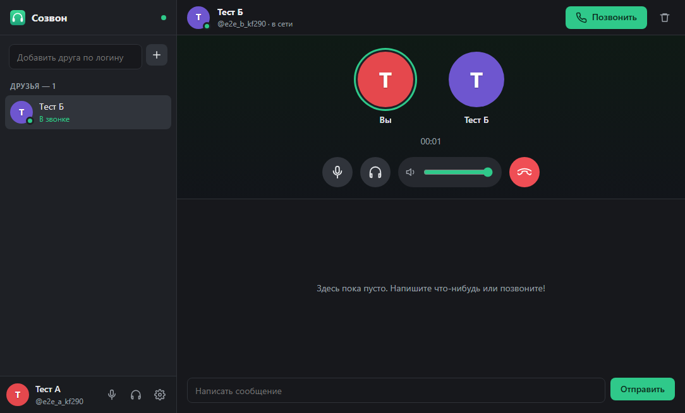

# Созвон

Голосовые звонки, видео и чат с друзьями — для игр и не только. Работает в России без VPN.

## Как это работает

- **Друзья.** Добавляете друга по логину — ему приходит заявка. Приняли — можно писать и звонить.
- **Звонки.** Голос и видео идут напрямую между компьютерами, сервер только помогает им найти друг друга. В звонок можно позвать ещё друзей — до 10 человек.
- **Каналы.** Свой «сервер» для компании: внутри голосовые и текстовые комнаты, роли и права. Друзей приглашают в канал целиком.
- **Сквозное шифрование.** Звук и видео шифруются ключами, которые создаются на ваших компьютерах, — сервер их не знает. В разговоре показан код из смайликов и цифр: если у всех он одинаковый, разговор слышат только участники. Личная переписка и чаты комнат тоже шифруются на устройстве: сервер хранит только шифр, а ключ переносится на новый компьютер одноразовым кодом.
- **Трансляция экрана** в 1440p 60 кадров/с, 1080p 60 или 720p 90 — со звуком игры, но без ваших собеседников в нём.
- **Чат** с разметкой, файлами, картинками, смайликами и превью ссылок.

## Установка

Скачайте `Sozvon-Setup-x.y.z.exe` на странице [Releases](../../releases) и запустите — он ставится для текущего пользователя без прав администратора. Дальше приложение обновляется само.

> Установщик не подписан сертификатом, поэтому Windows может показать «Система Windows защитила ваш компьютер». Нажмите **Подробнее → Выполнить в любом случае**.

Свой сервер для компании — в [docs/server.md](docs/server.md), разработка — в [docs/development.md](docs/development.md).

## Лицензия

MIT
