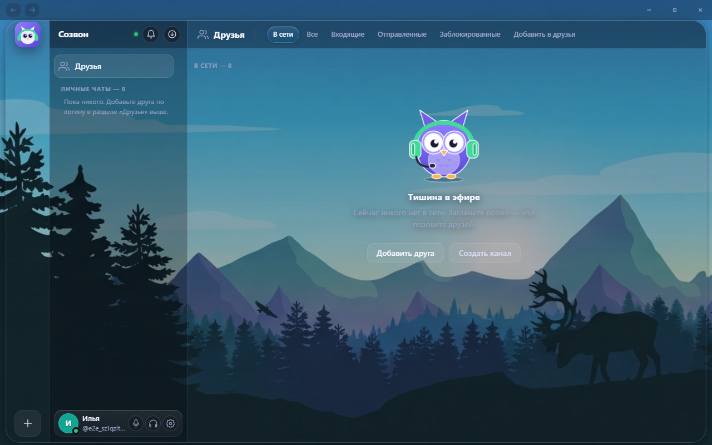

# Созвон

Голосовые звонки, видео и чат с друзьями — для игр и не только. Работает в России без VPN.

**Дизайн, который не мешает. Безопасность, которая встроена в приложение.**



**Дизайн:** десять тем, живой лес в «Совоне», аккуратная сетка и плавные переходы без визуального шума. **Безопасность:** сквозное шифрование, двухфакторная аутентификация и контроль активных устройств.

Скачать: [Releases](https://github.com/IlyaDasler/sozvon/releases) · [Code signing policy](docs/code-signing.md) · [Конфиденциальность](docs/privacy.md)

## Дизайн, который не мешает

Созвон не выглядит как пульт управления космическим кораблём. Это одно окно, в котором приятно проводить вечер: мягкая глубина, аккуратная типографика, честные отступы и ничего лишнего. Дизайн подчинён разговору, а не наоборот.

- **Тема «Совон»** — полупрозрачные панели с настоящим размытием, один плоский материал и тонкая кромка. Без пластиковых бликов и нарисованных объёмов.
- **Десять тем**, включая «Глубину», «Полночь», «Акварель», «Холод», «Лес» и «Феррари» с карбоновым фоном и F1-сценой.
- **Живые вкладки** — стеклянная плашка переезжает к активному разделу за 220 мс. Двигается только `transform`, без дёрганья и переливов ширины.
- **Читаемый чат** — сообщения и обсуждения занимают всю ширину панели; в треде лента уступает панели и перестраивается вместе с ней.
- **Больше воздуха**: скругления, ровная сетка, понятные состояния наведения и фокуса, поддержка уменьшения анимаций в системе.

## Безопасность по умолчанию

Созвон проектируется так, чтобы приватным было не только «обещание», но и устройство приложения.

- **Сквозное шифрование личных сообщений и комнат** — ECDH P-256 + AES-GCM. Ключ создаётся на вашем устройстве; сервер хранит только шифр и не может прочитать содержимое.
- **Звонки тоже шифруются.** Код из смайликов и цифр в разговоре показывает, что у всех участников один и тот же ключ. Если код отличается — разговор не тот, за кого себя выдаёт.
- **Ключ не уходит на сервер** — он переносится на новое устройство одноразовым кодом. Сервер видит только запечатанный конверт.
- **Двухфакторная аутентификация** (TOTP и резервные коды), список активных сессий с отзывом, настройки приватности профиля и видимости активности.
- **Сервер видит только метаданные**: имена, названия каналов и комнат, время и размер вложений. Содержимое переписки и звонков — нет.
- **Без рекламы, аналитики и сторонних трекеров.** Код открыт целиком (MIT): можно проверить, собрать самому и поднять собственный сервер.

## Как это работает

- **Друзья.** Добавляете друга по логину — ему приходит заявка. Приняли — можно писать и звонить.
- **Звонки.** Голос и видео идут напрямую между компьютерами, сервер только помогает им найти друг друга. В звонок можно позвать ещё друзей — до 10 человек.
- **Каналы.** Свой «сервер» для компании: внутри голосовые и текстовые комнаты, роли и права. Друзей приглашают в канал целиком.
- **Обсуждения.** Ответы живут в треде рядом с сообщением, не засоряя общую ленту; счётчик обновляется сразу.
- **Трансляция экрана** в 1440p 60 кадров/с, 1080p 60 или 720p 90 — со звуком игры, но без ваших собеседников в нём.
- **Чат** с разметкой, файлами, картинками, смайликами, GIF и превью ссылок.

## Свой сервер

Код открыт целиком — и клиент, и сервер (MIT). Приложение по умолчанию подключается к общему
серверу, но вы можете поставить свой: для семьи, друзей или команды, без чужого администрирования.

- **Поднять сервер:** одна команда на Ubuntu VPS — [`deploy/vps/setup.sh`](deploy/vps/setup.sh)
  (ставит Node.js, LiveKit, coturn, Caddy и systemd-службы). Подробная инструкция:
  [docs/self-hosting.md](docs/self-hosting.md).
- **Подключить приложение:** на экране входа нажмите «Свой сервер» и введите адрес.
  Выбор сохраняется; сменить позже — Настройки → Сервер.

## Установка

Скачайте `Sozvon-Setup-3.3.6.exe` на странице [Releases](../../releases) и запустите. Установщик ставится для текущего пользователя без прав администратора и **позволяет выбрать папку установки**. Дальше приложение обновляется само.

> Установщик не подписан сертификатом, поэтому Windows может показать «Система Windows защитила ваш компьютер». Нажмите **Подробнее → Выполнить в любом случае**.

Если загрузка с GitHub оборвалась, полный установщик и контрольная сумма лежат на нашем сервере:
[Sozvon-Setup-3.3.6.exe](https://135-106-226-12.sslip.io/updates/win/Sozvon-Setup-3.3.6.exe) · [SHA256SUMS-win.txt](https://135-106-226-12.sslip.io/updates/win/SHA256SUMS-win.txt).

### macOS

На странице [Releases](../../releases) возьмите `Sozvon-<версия>-arm64.dmg` (Apple Silicon, M1–M4) или `Sozvon-<версия>-x64.dmg` (Intel), откройте и перетащите «Созвон» в «Программы».

Версия **3.3.6 обновляется автоматически с нашего сервера**, без GitHub. Если у вас установлена старая 2.9.x или 3.0.0, первый переход на 3.3 нужно сделать один раз вручную — старый встроенный апдейтер не умеет новый редирект:

- [Sozvon-3.3.6-arm64.dmg](https://135-106-226-12.sslip.io/updates/mac/Sozvon-3.3.6-arm64.dmg) — Apple Silicon
- [Sozvon-3.3.6-x64.dmg](https://135-106-226-12.sslip.io/updates/mac/Sozvon-3.3.6-x64.dmg) — Intel

> **Запускайте только из «Программ».** Если открыть приложение прямо из образа, macOS запускает его из временной папки: обновления не смогут установиться, а после перезагрузки ярлык перестанет работать. Приложение предупредит об этом при первом запуске из образа.

> Если загрузка оборвалась, macOS напишет «образ повреждён». Проверить файл до установки можно по контрольной сумме из релиза (`SHA256SUMS-mac.txt`): `shasum -a 256 -c SHA256SUMS-mac.txt` в папке с загруженными файлами.

> Сборка для macOS не подписана сертификатом Apple, поэтому при первом запуске система скажет, что разработчик не проверен. Нажмите по приложению **правой кнопкой → «Открыть» → «Открыть»** (один раз, дальше запускается обычно).
>
> Если вместо этого macOS пишет «приложение повреждено, переместите в Корзину» — это про подпись, а не про файл. Откройте Терминал и выполните:
>
> ```
> sudo xattr -cr /Applications/Sozvon.app
> sudo codesign --force --deep --sign - /Applications/Sozvon.app
> ```
>
> Автообновление на macOS работает без сертификата Apple; после обновления система заново спросит доступ к микрофону, камере и экрану (разрешения привязаны к подписи). Звук при показе экрана передаётся в Windows и на macOS 14.2+ — система спросит разрешение «Запись звука системы»; на более старых macOS трансляция идёт без звука.

## Лицензия

MIT

## Ветки

- **main** — единственная ветка для правок и релизов.
- **beta-version** — тестовые сборки клиента и сервера.
- Ветки `release/*` больше не используются; релиз собирается и выпускается из `main`.